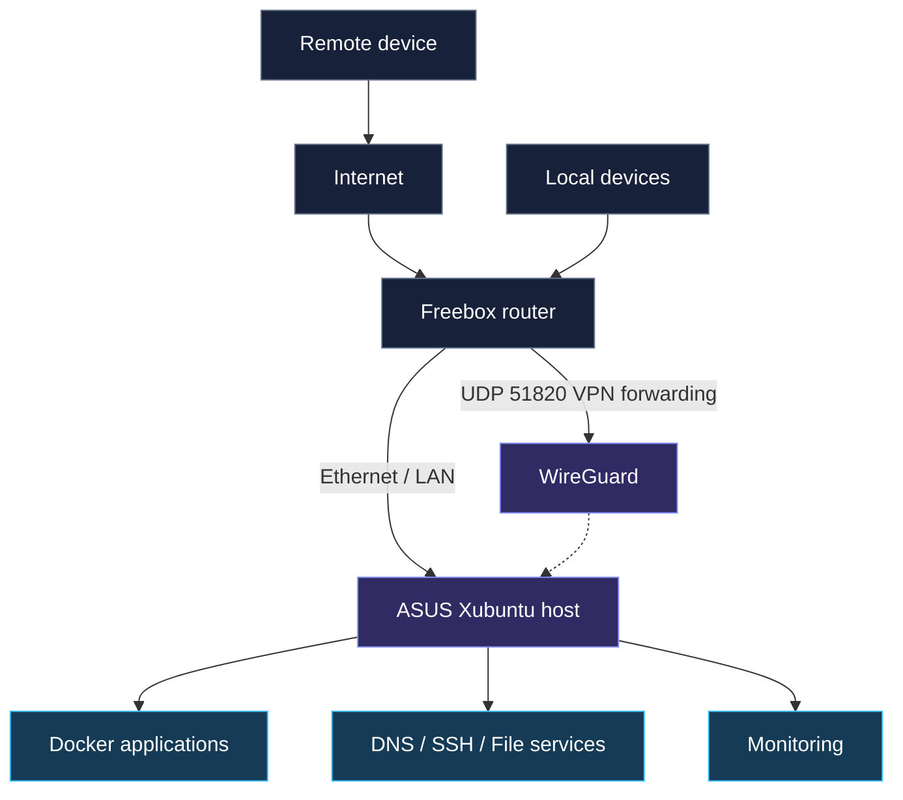

<h3 align="center">NETWORK INFRASTRUCTURE · LINUX · SELF-HOSTING · SECURITY</h3>

An ASUS laptop repurposed as a personal Linux server. A hands-on lab for network services, containers, secure remote access and monitoring.

---

## Project overview

This repository documents a self-hosted homelab for learning **network engineering, Linux administration, automation and cybersecurity**.

**The documented setup is not a live status page.** The host is currently offline and its precise OS version, exposed ports, service states and scheduled backups still need revalidation.

## Network at a glance

[**Explore the full network topology**](docs/network-architecture.md) · [**Network access & ports**](docs/network-ports.md)

## Service directory

**Click any service badge to open its dedicated technical page.** These badges identify technologies; they do not report live health.

### Networking & security

  
  
  
  
  
  

### Containers & applications

  
  
  
  
  
  
  

### Monitoring

  
  

## Technical documentation

| Subject | Detailed guide |
|---|---|
| Server specifications and limitations | [Hardware & system](docs/hardware.md) |
| Logical network design | [Network architecture](docs/network-architecture.md) |
| Network ports and access policy | [Network ports](docs/network-ports.md) |
| Access control, SSH, firewall and security improvements | [Security & hardening](docs/security.md) |
| Planned backup schedule and recovery testing | [Backup & recovery](docs/backup-recovery.md) |
| Infrastructure monitoring and metrics | [Monitoring](docs/monitoring.md) |
| Improvement milestones | [Roadmap](docs/roadmap.md) |
| Individual service pages | [All services](docs/services/README.md) |

## Next milestones

- [ ] Verify current OS version and the deployed service inventory
- [ ] Check accessible ports, Docker mappings and IPv6 exposure
- [ ] Add redacted screenshots and reproducible config examples
- [ ] Validate automatic backups and recovery tests
- [ ] Improve SSH authentication and internal HTTPS
- [ ] Plan an SSD upgrade for the HDD-based host

> **Security:** No VPN private keys, .env files, account credentials, backup archives or unredacted screenshots belong in this public repository.

---

<strong>Owen-Junior Jean</strong> · Network Engineering & Cybersecurity <a href="https://github.com/lilouwen">GitHub</a> · <a href="https://www.linkedin.com/in/owen-junior-jean/">LinkedIn</a>

