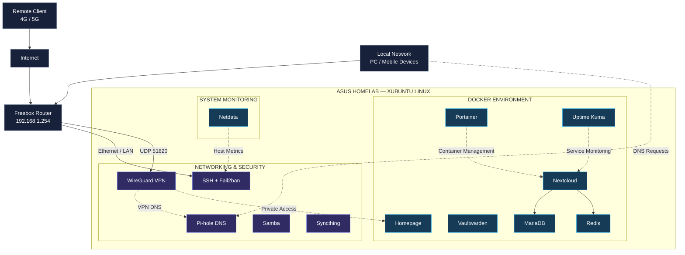

<p align="center">
  
</p>

<h3 align="center">
  NETWORK INFRASTRUCTURE · SELF-HOSTING · CYBERSECURITY
</h3>

<p align="center">
  <strong>Transforming an ASUS laptop into a self-hosted Linux infrastructure.</strong>
</p>

<p align="center">
  A personal laboratory for Linux administration, networking,
  virtualization, containerization, monitoring and security.
</p>

<p align="center">
  
  
  
  
</p>

<p align="center">
  <a href="https://github.com/lilouwen">
    
  </a>
  <a href="https://www.linkedin.com/in/owen-junior-jean/">
    
  </a>
</p>

---

# Project Overview

This project documents the transformation of a repurposed ASUS laptop into a personal Linux server.

The infrastructure provides self-hosted services including DNS filtering, VPN access, private cloud storage, password management, file sharing and system monitoring.

The main objective is to develop practical skills in **network engineering, cybersecurity, Linux system administration and infrastructure management**.

### Core Objectives

- Deploy and maintain a Linux-based server.
- Build and manage a self-hosted infrastructure.
- Configure networking and DNS services.
- Implement secure remote access through VPN.
- Deploy and manage Docker containers.
- Monitor infrastructure availability and performance.
- Improve system hardening and access control.
- Develop backup and recovery procedures.
- Document technical decisions and troubleshooting.

> **Project philosophy:** Build, understand, secure, monitor and continuously improve.

---

# Table of Contents

- [Hardware and System](#hardware-and-system)
- [Network Architecture](#network-architecture)
- [Remote Access](#remote-access)
- [Infrastructure Services](#infrastructure-services)
- [Docker Environment](#docker-environment)
- [Network Ports and Access](#network-ports-and-access)
- [Security and Hardening](#security-and-hardening)
- [Backup and Recovery](#backup-and-recovery)
- [Monitoring](#monitoring)
- [Results and Limitations](#results-and-limitations)
- [Project Roadmap](#project-roadmap)
- [Repository Security](#repository-security)
- [Author](#author)

---

# Hardware and System

## Server Specifications

The homelab runs on a repurposed ASUS laptop connected to the local network through Ethernet.

| Component | Specification |
|---|---|
| Hardware | ASUS Laptop |
| Processor | Dual-Core CPU |
| Memory | 6 GB RAM |
| Storage | Approximately 686 GB HDD |
| Operating System | Xubuntu 26.04 LTS |
| Connection | Ethernet |
| Local IP | `192.168.1.187` |
| Gateway | Freebox — `192.168.1.254` |
| VPN Subnet | `10.7.0.0/24` |

The laptop has been repurposed to provide an always-available local infrastructure without requiring dedicated enterprise server hardware.

Xubuntu provides a graphical environment for local maintenance, while daily administration is primarily performed remotely using SSH.

### Infrastructure Constraints

The hardware introduces several limitations:

- Limited CPU resources.
- 6 GB of available memory.
- HDD storage performance constraints.
- Single-machine dependency.
- No hardware redundancy.

These constraints make resource management, monitoring and backup procedures essential parts of the project.

---

# Network Architecture

The infrastructure is built around a Freebox router and a Linux server hosting multiple networking, security and application services.

## Logical Network Topology



### Architecture Explanation

The Freebox acts as the main gateway between the home network and the Internet.

The ASUS laptop hosts the Linux infrastructure and its associated services.

The architecture is organized into three functional areas:

**Networking & Security**

- Private network connectivity.
- DNS filtering.
- VPN access.
- SSH administration.
- File sharing and synchronization.
- Authentication protection.

**Containerized Applications**

- Private cloud storage.
- Password management.
- Service dashboard.
- Container administration.
- Availability monitoring.

**System Monitoring**

- Resource utilization.
- Service availability.
- Storage performance.
- Network activity.

The diagram represents a logical grouping of services, not necessarily their exact deployment method or network isolation.

---

# Remote Access

Remote access is provided through a WireGuard VPN tunnel.

WireGuard allows authorized devices to communicate with internal homelab services while avoiding intentional direct Internet exposure of application administration interfaces.

## VPN Configuration

| Parameter | Value |
|---|---|
| VPN Technology | WireGuard |
| Transport | UDP |
| Listening Port | `51820` |
| VPN Server | `10.7.0.1/24` |
| Documented Mobile Client | `10.7.0.2/24` |
| VPN Network | `10.7.0.0/24` |

The Freebox forwards UDP port `51820` to the VPN server.

## Remote Connection Flow


### Documented Connectivity Test

A remote connection test was performed using a mobile phone over a 4G/5G network.

The recorded results indicate:

- Successful WireGuard handshake.
- Traffic transmitted and received through the tunnel.
- Access to internal resources.
- DNS filtering through Pi-hole while connected to the VPN.

These observations come from the deployment documentation and should be revalidated after configuration changes.

### Security Principle

Only authorized VPN peers should be allowed to access the private infrastructure.

Application access remains subject to local firewall rules and service-specific authentication.

---

# Infrastructure Services

The homelab combines networking services, system administration tools and self-hosted applications.

## Networking & Security

| Service | Purpose |
|---|---|
| **Pi-hole** | Network-wide DNS filtering and DNS query monitoring |
| **WireGuard** | Secure remote VPN connectivity |
| **OpenSSH** | Remote Linux administration |
| **Fail2ban** | Protection against repeated authentication failures |
| **Samba** | File sharing with Windows clients |
| **Syncthing** | File synchronization between devices |

### Pi-hole

Pi-hole provides DNS-based filtering for devices configured to use the homelab DNS server.

Its main functions include:

- DNS query processing.
- Domain-based filtering.
- Advertisement and tracking domain blocking.
- DNS activity statistics.
- Filtering for VPN clients.

The documented configuration uses the Linux server as a DNS endpoint for selected devices.

### WireGuard

WireGuard provides an encrypted tunnel between remote devices and the home network.

The VPN is used to access internal infrastructure services from outside the local network.

### OpenSSH

SSH provides remote command-line administration of the Linux server.

It is used for:

- System configuration.
- Package management.
- Container administration.
- Log inspection.
- Troubleshooting.

### Fail2ban

Fail2ban monitors authentication failures and can temporarily block sources that exceed configured thresholds.

The deployment documentation describes Fail2ban as active and enabled at system startup, particularly for SSH protection.

### Samba

Samba provides file sharing between the Linux server and Windows devices.

The documented configuration uses authenticated access rather than guest access.

### Syncthing

Syncthing provides direct file synchronization between devices.

It complements cloud storage services but does not replace independent backups.

---

# Docker Environment

Docker is used to deploy and manage multiple self-hosted applications.

Portainer provides a web-based management interface for containers, images, networks, volumes and stacks.

## Containerized Services

| Container | Description |
|---|---|
| `homepage` | Central dashboard for homelab applications |
| `nextcloud` | Private cloud and file collaboration |
| `nextcloud-db` | MariaDB database for Nextcloud |
| `nextcloud-redis` | Redis service associated with Nextcloud |
| `vaultwarden` | Self-hosted password manager |
| `uptime-kuma` | Service availability monitoring |
| `portainer` | Docker management interface |

These containers were identified in the deployment documentation. Their current runtime state should be verified on the server.

## Homepage

Homepage acts as the central entry point for the homelab.

It provides organized access to self-hosted applications and infrastructure management tools.

## Nextcloud

Nextcloud provides personal cloud storage and file management.

The documented deployment includes:

- Nextcloud application.
- MariaDB database.
- Redis service.

Future improvements may include additional collaboration features and more robust backup procedures.

## Vaultwarden

Vaultwarden provides a self-hosted password management service compatible with Bitwarden clients.

The documented configuration uses an Argon2id-hashed administration secret.

The secret and its hash must remain outside this public repository.

## Portainer

Portainer provides centralized Docker management.

Main functions include:

- Container inspection.
- Image management.
- Docker volume administration.
- Docker networking.
- Stack deployment and maintenance.

---

# Network Ports and Access

The following table documents the local services and their associated ports.

These addresses are private and are intended for access through the local network or VPN, subject to the configured security rules.

| Service | Port / Protocol | Purpose |
|---|---|---|
| SSH | `22/TCP` | Remote administration |
| Pi-hole DNS | `53/TCP`, `53/UDP` | DNS filtering |
| Pi-hole Web | `80/TCP` | DNS management interface |
| Homepage | `3000/TCP` | Homelab dashboard |
| Uptime Kuma | `3001/TCP` | Availability monitoring |
| Vaultwarden | `8080/TCP` | Password manager |
| Nextcloud | `8081/TCP` | Private cloud |
| Syncthing Web | `8384/TCP` | Synchronization management |
| Syncthing Sync | `22000` | File synchronization transport |
| Portainer | `9443/TCP` | Docker administration |
| Netdata | `19999/TCP` | System monitoring |
| WireGuard | `51820/UDP` | Remote VPN access |
| Samba | `445/TCP` | Windows file sharing |

**Important:** This table documents reported or expected port assignments. The current listening ports, Docker mappings, Syncthing transport configuration and Samba configuration must be checked on the server.

## Network Exposure Policy

The intended exposure model is:

- WireGuard provides the external remote access entry point.
- Web administration interfaces remain restricted to trusted networks.
- SSH is intended for authorized administration.
- DNS is provided to selected LAN and VPN clients.
- Database services are not intentionally published directly to the Internet.

The actual exposure must be verified against router rules, host firewall rules, Docker port publishing and IPv6 connectivity.

---

# Security and Hardening

Security is a core objective of the homelab.

The infrastructure is designed to provide remote access while limiting unnecessary service exposure.

## Documented Security Measures

| Control | Description |
|---|---|
| WireGuard | Encrypted remote access tunnel |
| Fail2ban | Authentication abuse protection |
| SSH | Remote administration with authentication |
| Private Network | Internal access to application services |
| Samba Authentication | Restricted file share access |
| Vaultwarden | Protected administration credentials |
| DNS Filtering | Pi-hole filtering and logging |

## Current Security Approach

**Network Access**

The intended configuration uses WireGuard as the primary remote access method.

Internal application management interfaces are not deliberately exposed directly to the Internet.

**Authentication**

Sensitive services require authenticated access.

Samba is documented as requiring an authorized user, with guest access disabled.

**Host Protection**

Fail2ban is used to help protect SSH against repeated authentication attempts.

**Credential Protection**

Passwords, VPN private keys, tokens and other secrets are excluded from public documentation.

## Security Improvements

Planned improvements include:

- [ ] Verify all exposed TCP and UDP ports.
- [ ] Review Freebox port forwarding rules.
- [ ] Review IPv6 exposure.
- [ ] Audit Docker published ports.
- [ ] Verify host firewall rules.
- [ ] Configure SSH key-only authentication.
- [ ] Disable SSH password authentication after validating key access.
- [ ] Implement HTTPS for sensitive web applications.
- [ ] Review container permissions and isolation.
- [ ] Maintain regular security updates.
- [ ] Document security tests and their results.

### HTTPS and Reverse Proxy

A future objective is to implement HTTPS for internal services through a reverse proxy.

This will improve web interface security, particularly for sensitive applications such as Vaultwarden and Nextcloud.

Certificate validation and trusted access from authorized devices will form part of this deployment.

---

# Backup and Recovery

Backup reliability is essential because the infrastructure currently relies on a single physical machine and storage device.

## Planned Backup Schedule

The following schedule was proposed in the deployment documentation.

Its execution, timezone configuration and recovery reliability have not yet been fully validated.

| Scheduled Time | Service | Data |
|---|---|---|
| `03:00` | Vaultwarden | Docker volume |
| `03:10` | WireGuard | VPN configuration |
| `03:20` | Pi-hole | DNS configuration |
| `03:30` | Backup Rotation | Archives older than 14 days |

## Backup Organization

A proposed local directory structure is:

```text
backups/
├── vaultwarden/
├── wireguard/
└── pihole/
```

This structure represents the planned backup organization, not proof that the jobs are currently running.

## Backup Strategy

The backup process should provide:

- Scheduled execution.
- Restricted access to archives.
- Protection of sensitive configuration files.
- Defined retention policies.
- Consistent database backups.
- Independent storage copies.
- Recovery testing.

## Recovery Improvements

- [ ] Validate automated backup execution.
- [ ] Validate archive retention.
- [ ] Test Vaultwarden recovery.
- [ ] Test WireGuard recovery.
- [ ] Test Pi-hole recovery.
- [ ] Back up Nextcloud configuration and data.
- [ ] Implement consistent MariaDB backups.
- [ ] Back up important Samba files.
- [ ] Store encrypted backup copies outside the server.
- [ ] Perform a complete recovery test.

### Important Limitation

Backups stored on the same physical HDD do not protect against disk failure.

Syncthing and Nextcloud synchronization also do not replace independent versioned backups.

---

# Monitoring

Monitoring is used to evaluate service availability, system resource consumption and infrastructure health.

## Uptime Kuma

Uptime Kuma provides service availability monitoring.

The documented monitoring targets include:

- Pi-hole.
- Portainer.
- Vaultwarden.
- Netdata.
- Nextcloud.
- SSH.
- Freebox.

### Monitoring Objectives

- Detect service unavailability.
- Monitor response times.
- Maintain availability history.
- Identify recurring failures.
- Configure notifications for important incidents.

## Netdata

Netdata provides infrastructure performance monitoring.

Key metrics include:

| Metric | Purpose |
|---|---|
| CPU Usage | Monitor processor utilization |
| RAM Usage | Identify memory pressure |
| Swap Usage | Detect memory limitations |
| Disk I/O | Analyze storage bottlenecks |
| Disk Usage | Monitor available storage |
| Network Traffic | Analyze network activity |
| System Load | Evaluate host performance |
| Processes | Identify resource-intensive applications |

### Hardware Monitoring Focus

Because the server relies on an HDD and has only 6 GB of RAM, storage I/O and memory consumption are especially important.

These measurements can help determine when hardware upgrades become necessary.

## Monitoring Improvements

- [ ] Enable critical service notifications.
- [ ] Document monitoring thresholds.
- [ ] Add sanitized dashboard screenshots.
- [ ] Record baseline CPU and RAM usage.
- [ ] Measure disk I/O under load.
- [ ] Document service incident scenarios.
- [ ] Evaluate additional security monitoring.

---

# Results and Limitations

## Documented Results

The project demonstrates the reuse of consumer hardware to build a self-hosted infrastructure.

The deployment documentation covers:

- Linux server administration.
- Local DNS filtering.
- VPN remote access.
- Self-hosted cloud storage.
- Password management.
- Docker container administration.
- Network file sharing.
- File synchronization.
- Service availability monitoring.
- Host performance monitoring.

## Technical Challenges

### Limited Hardware Resources

The server operates with a dual-core CPU, 6 GB of RAM and HDD storage.

Resource-intensive services such as databases and cloud applications can place significant pressure on the hardware.

### Storage Performance

The HDD is identified as a major potential performance bottleneck.

Migrating to an SSD is a priority for improving application responsiveness and disk I/O performance.

### Single Point of Failure

All services depend on one physical machine.

Hardware failure, power loss or storage corruption can affect the entire infrastructure.

### Backup Resilience

Local backup procedures still require validation and an independent storage destination.

### Network Security

The intended LAN/VPN access model still requires verification of actual firewall, router, Docker and IPv6 exposure.

## Lessons Learned

This homelab provides practical experience in:

- Infrastructure design.
- Network service deployment.
- Linux administration.
- Container management.
- Secure remote connectivity.
- Troubleshooting.
- Resource monitoring.
- Infrastructure documentation.

---

# Project Roadmap

The project will evolve incrementally, focusing on security, resilience, performance and automation.

## Phase 1 — Infrastructure Documentation

- [x] Document the hardware configuration.
- [x] Document the logical network architecture.
- [x] Identify infrastructure services.
- [x] Document reported service ports.
- [ ] Verify the current operating system version.
- [ ] Verify actual service status and listening ports.
- [ ] Add real infrastructure screenshots.
- [ ] Document Docker Compose deployments.

## Phase 2 — Security Improvements

- [ ] Audit exposed services.
- [ ] Review firewall and router rules.
- [ ] Configure SSH key-only authentication.
- [ ] Deploy internal HTTPS.
- [ ] Implement a reverse proxy.
- [ ] Review Docker container permissions.
- [ ] Document security validation procedures.

## Phase 3 — Monitoring & Reliability

- [ ] Configure Uptime Kuma notifications.
- [ ] Establish system performance baselines.
- [ ] Verify automated backup jobs.
- [ ] Implement external or off-site backups.
- [ ] Test complete service recovery.
- [ ] Improve troubleshooting documentation.

## Phase 4 — Infrastructure Evolution

- [ ] Upgrade HDD storage to SSD.
- [ ] Improve WireGuard monitoring.
- [ ] Explore Suricata IDS.
- [ ] Evaluate additional infrastructure automation.
- [ ] Explore integration of a LILYGO device as a homelab console.
- [ ] Evaluate office productivity integration with Nextcloud.

---

# Repository Security

This repository is intended for technical documentation and sanitized configuration examples.

Sensitive information must never be committed to the repository.

## Excluded Information

- Passwords.
- Private SSH keys.
- WireGuard private keys.
- WireGuard configuration files containing secrets.
- VPN QR codes.
- API tokens.
- `.env` files.
- Vaultwarden administration secrets.
- Database credentials.
- Database exports containing personal data.
- Backup archives.
- Public IP addresses and sensitive access details.

Configuration examples should use placeholders rather than real credentials.

Screenshots must be reviewed before publication to remove sensitive information.

---

# Author

<div align="center">

### Owen-Junior Jean

**Networks & Telecommunications Graduate**

Cybersecurity · Network Engineering · Linux Infrastructure · Automation

<p>
  <a href="https://github.com/lilouwen">
    
  </a>
  <a href="https://www.linkedin.com/in/owen-junior-jean/">
    
  </a>
</p>

**Building, securing and improving infrastructure through hands-on experimentation.**

</div>

<p align="center">
  
</p>
