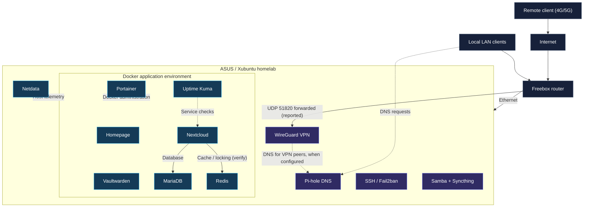

# Network architecture

[← Documentation](README.md) · [← Repository home](../README.md)

> **Logical topology, not a verified current network map.** Service grouping is based on deployment notes. Actual listeners, Docker networks, routing and firewall restrictions need to be checked when the homelab is online.

## Overview

The homelab uses an ASUS laptop running Xubuntu as a shared physical host behind a Freebox router. The prior report documents local DNS, a WireGuard entry point, containerized applications and host/service monitoring.

**Read the diagram as a service map**, not as proof of exact network isolation. Some components run directly on the host; Docker placement is included only where supported by the previously recorded container list.

## Logical zones and trust boundaries

| Zone | Intent | Verification required |
|---|---|---|
| Internet | External connectivity | Publicly forwarded IPv4/IPv6 services |
| Freebox gateway | Router and port forwarding | UDP 51820 rule and any other forwards |
| Local LAN | Permitted internal devices | Client routing, DNS, management access |
| WireGuard tunnel | Authenticated remote peers | Peer list, routes and host firewall |
| Xubuntu host | Host system services | SSH, DNS, file sharing listeners |
| Docker environment | Containerized applications | Bridge networks, published ports and volume access |
| Observability | Availability and performance signals | Uptime Kuma target list and Netdata access |

## Reported addresses (historical)

- Freebox LAN gateway: `192.168.1.254`
- ASUS host LAN address: `192.168.1.187`
- WireGuard network: `10.7.0.0/24`
- WireGuard host address: `10.7.0.1/24`
- One previously documented remote peer: `10.7.0.2/24`

These private addresses are not access credentials. They may no longer match the current deployment.

## Technical design questions

1. Are services explicitly bound to LAN-only or VPN-only interfaces?
2. Does Docker publish any port on all IPv4/IPv6 interfaces?
3. Which host firewall rules permit DNS, SSH, application UIs and WireGuard?
4. How do remote VPN peers obtain a return route to local services?
5. Are administrative interfaces accessible to untrusted external networks?
6. Are database/cache ports only reachable from intended containers?

[Network ports](network-ports.md) · [WireGuard deep dive](services/wireguard.md) · [Verification playbook](guides/verification.md)

---

[← Repository home](../README.md)
