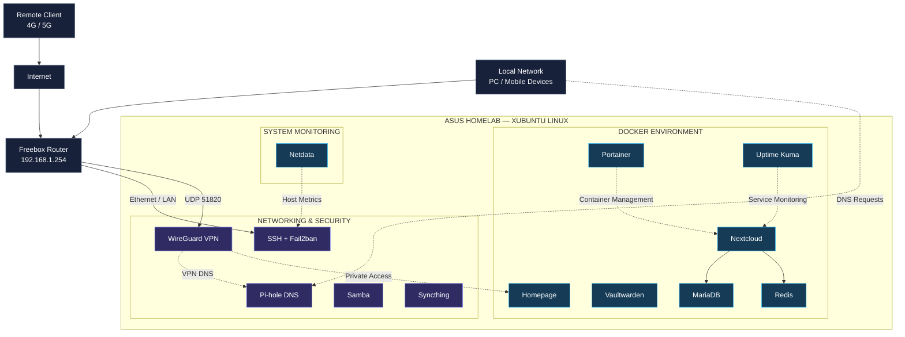

# Network architecture

## Network Architecture

The infrastructure is built around a Freebox router and a Linux server hosting multiple networking, security and application services.

## Logical Network Topology

### Architecture Explanation

The Freebox acts as the main gateway between the home network and the Internet.

The ASUS laptop hosts the Linux infrastructure and its associated services.

The architecture is organized into three functional areas:

**Networking & Security**

- Private network connectivity.
- DNS filtering.
- VPN access.
- SSH administration.
- File sharing and synchronization.
- Authentication protection.

**Containerized Applications**

- Private cloud storage.
- Password management.
- Service dashboard.
- Container administration.
- Availability monitoring.

**System Monitoring**

- Resource utilization.
- Service availability.
- Storage performance.
- Network activity.

The diagram represents a logical grouping of services, not necessarily their exact deployment method or network isolation.

---

[← Repository home](../README.md) · [Service directory](services/README.md)
