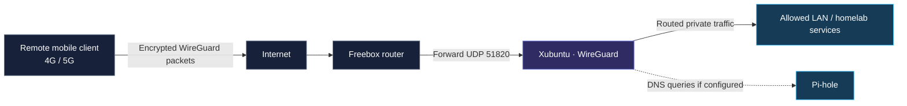

# WireGuard · Remote Access VPN

[← Service directory](README.md) · [Repository home](../../README.md)


> **Documentation status:** Describes a previously tested homelab deployment. The server is currently offline; this page does **not** assert that the tunnel, firewall, DNS or routing is working now.

## 01 // Objective

Provide an encrypted, authenticated entry point for selected remote devices to reach permitted services in the private homelab, without deliberately publishing each service's web interface on the public Internet.

- **Remote client:** Mobile phone over 4G/5G (previous test)
- **VPN endpoint:** WireGuard on the ASUS Xubuntu host
- **Edge router:** Freebox, with a documented UDP forwarding rule
- **Internal DNS:** Pi-hole for VPN peers, according to the previous test notes
- **Access control:** WireGuard peer authorization **plus** host/network firewall and application authentication

## 02 // Logical architecture



**Scope:** This is a logical traffic flow. It does not prove the server's current firewall policies, IP forwarding, NAT implementation, IPv6 policy or accessible services.

## 03 // Reported deployment parameters

| Component | Documented value | Verification |
|---|---|---|
| VPN software | WireGuard | Recheck installed package and interface |
| Transport protocol | UDP | Recheck listener |
| Router forwarding | UDP `51820` to VPN host | Recheck Freebox rules |
| VPN subnet | `10.7.0.0/24` | Recheck peer addressing |
| Server tunnel address | `10.7.0.1/24` | Recheck `wg0` |
| Remote mobile peer | `10.7.0.2/24` | Recheck active peer configuration |
| DNS for VPN client | Pi-hole on the homelab | Recheck resolution and client DNS setting |
| Application access | Intended for LAN / VPN | Audit reachable ports and access rules |

Private RFC1918 addresses are shown as historical lab context. **Do not publish** a real public endpoint, peer QR codes, private keys, pre-shared keys or complete active configuration files.

## 04 // Previously documented validation

The original homelab notes recorded a successful test while a phone was connected over mobile data:

1. WireGuard handshake completed.
2. Encrypted traffic counters increased.
3. Internal resources were reached through the VPN.
4. The phone used Pi-hole for DNS filtering while on the tunnel.

These were **historical observations**, not fresh test results.

## 05 // Security model

| Layer | Expected role |
|---|---|
| VPN peer | Authenticate with a valid WireGuard public/private key pair |
| Router | Forward only the required VPN UDP listener (verify current settings) |
| Host firewall | Permit only intended client-to-service traffic |
| DNS | Answer permitted VPN clients; avoid exposing a public resolver |
| Applications | Require independent authentication |
| Administration | Prefer VPN-gated management interfaces rather than public exposure |

**Audit points:** Client `AllowedIPs` defines routes accepted locally; it is not a substitute for server firewall rules. Whether LAN hosts can send return traffic to VPN clients depends on the actual routing/NAT setup. IPv6 and Docker-published ports should be reviewed separately.

## 06 // Operational verification (when the host is online)

The following commands are **not output from this server**. They are a checklist to run later, with sensitive fields redacted before sharing results.

```bash
# Check whether the WireGuard service is running
systemctl is-active wg-quick@wg0

# Verify the interface and its addresses
ip -br address show wg0

# Inspect WireGuard peer state locally
sudo wg show

# Verify the local UDP listener
sudo ss -lunp | grep ':51820'
```

**Privacy:** `sudo wg show` can expose peer public keys and endpoint IP addresses. Redact those fields before publishing screenshots or command output.

### Client-side functional checks

| Test | Expected result |
|---|---|
| Connect from mobile data, not home Wi-Fi | Tunnel establishes |
| Review latest handshake and traffic counters | Traffic increases when using services |
| Access an authorized internal service | Works through VPN |
| Query an internal DNS name | Resolved by the configured DNS server |
| Attempt an unauthorized service | Blocked according to firewall policy |
| Disconnect the tunnel | VPN-only service is no longer reachable externally |

Do not claim a test passed until a dated result has been recorded.

## 07 // Troubleshooting framework

| Symptom | Initial investigation |
|---|---|
| No handshake | Endpoint address, port forwarding, carrier/network restrictions, router rules |
| Handshake but no application access | Routing, forwarding, firewall policy, host listeners, client AllowedIPs |
| Internal IP works but hostname fails | DNS settings on the client and Pi-hole availability |
| Only some services reachable | Application binding address, Docker-published ports and access restrictions |
| Intermittent connectivity | Network changes, mobile handover, tunnel keepalive settings if applicable |

**Principle:** Record the hypothesis, verification steps and observed results before changing the configuration.

## 08 // Improvement backlog

- [ ] Reconfirm the WireGuard version and current `wg0` interface state
- [ ] Verify the Freebox UDP forwarding rule
- [ ] Audit allowed peers and remove unused access
- [ ] Validate host firewall forwarding and per-service authorization
- [ ] Check DNS resolution through Pi-hole from a VPN client
- [ ] Test LAN return routing and IPv6 exposure
- [ ] Record sanitized results from a fresh 4G/5G connection test
- [ ] Document how encrypted WireGuard configuration backups are restored
- [ ] Review current service access behind VPN and internal HTTPS

## Related documentation

- [Full network architecture](../network-architecture.md)
- [Network ports and access model](../network-ports.md)
- [Security and hardening](../security.md)
- [Backup and recovery](../backup-recovery.md)
- [Pi-hole DNS filtering](pi-hole.md)

---

[← Service directory](README.md) · [Repository home](../../README.md)
